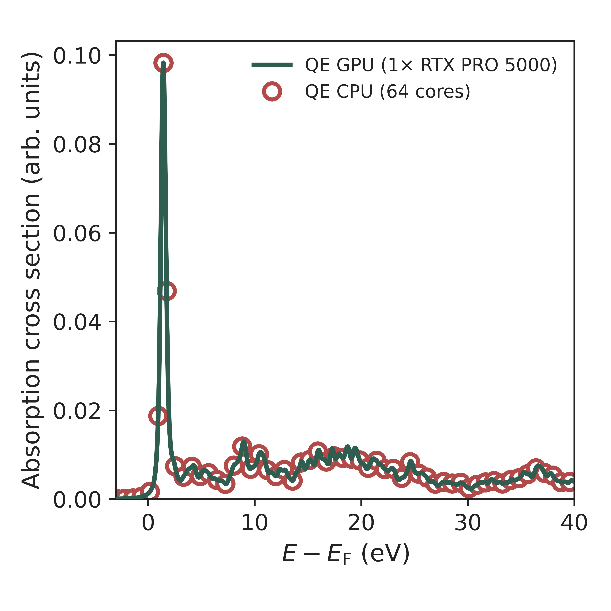
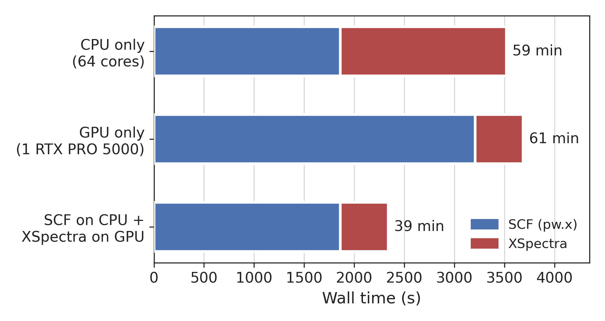

# XSpectra on the GPU (OpenACC) — patches for dm_qe

GPU port of Quantum ESPRESSO's `xspectra.x`: X-ray absorption, K edge, dipole and quadrupole, and the
L₃ edge, with ultrasoft/PAW pseudopotentials. It runs on top of
[Discovered Materials' GPU fork of Quantum ESPRESSO (dm_qe)](https://github.com/discovered-materials/dm_qe).

This repository contains **only our changes**, as `git format-patch` patches, together with the build
and run scripts, the analysis tools and the validation and timing results. The base code is not
included: get it from the dm_qe repository and apply the patches.

## Applying the patches

```bash
git clone https://github.com/discovered-materials/dm_qe.git
cd dm_qe
git checkout -b xspectra-gpu 459623780      # base commit the patches were made on
git submodule update --init
git am /path/to/this/repo/patches/*.patch
```

The 9 patches apply cleanly to `459623780`. The resulting tree is identical to the branch that was
built and tested. Build with the dm_qe GPU configuration (NVHPC, `-DQE_GPU="openacc;cuda"`); the target
is `qe_xspectra_exe`:

```bash
SRC=$PWD BLD=$PWD/build_gpu FFTW3_ROOT=/path/to/fftw bash /path/to/this/repo/scripts/build_xspectra.sh
```

See the comments in `scripts/build_xspectra.sh` for the GPU architectures, the CPU reference build,
and the host target option for GPU hosts without AVX-512.

| patch | content | affects |
|---|---|---|
| 0001 | local: `-Mnoinline` for wannier90 `disentangle.F90` (nvfortran 26.3 internal compiler error) | build only |
| 0002 | GPU step 1: device data regions around `h_psi` in the Lanczos routines | GPU build |
| 0003 | `use_gpu = check_gpu_support()` at start-up (without it `h_psi` used a stale host `becp`) | GPU build |
| 0004 | GPU step 2: device-resident Lanczos recursion and S⁻¹ (`lanczos_acc.f90`, `sm1_psi_acc`) | GPU build |
| 0005 | norm-conserving Lanczos stops with an error on the GPU (not validated) | GPU build |
| 0006 | timing breakdown (clocks only) | both |
| 0007 | S⁻¹ matrix B = vkb^H vkb built on the device, once per k-point (it was 800 s of a 1040 s run) | GPU build |
| 0008 | the SCF wavefunctions are no longer read and copied (XSpectra never uses them) | both, bit-identical results |
| 0009 | optional `xepsilon_xyz = .true.`: x, y and z polarizations in one run (default off) | both |

The CPU build gives bit-identical results before and after these patches (checked with Intel/MKL),
except for the timing printout.

## Validation

- **Criterion**: GPU results must lie within the spread of CPU runs that differ only in the number of
  MPI ranks and in the compiler (NVHPC and Intel). CPU runs are not bitwise reproducible, because
  FFTW_MEASURE chooses its algorithm by timing. The checks are:
  - Lanczos a, b over the first 50 iterations agree to ≤ 1e-10;
  - spectrum difference ≤ the largest CPU–CPU difference;
  - iteration counts agree to ±10 %.
  
  Script: `tools/ensemble_check.py`.
- **162-atom SiO₂ cell**: GPU vs CPU reading the same SCF data gives
  first 50 iterations ≤ 5e-12 and a spectrum difference ≤ 1.2e-3 of the maximum.

<p align="center"></p>

The figure shows the Si K edge of 162-atom SiO₂ (x polarization, Lanczos run to convergence), from the
same SCF save and the same code: CPU (64 cores, open circles) and GPU (one RTX PRO 5000, line). Both are
broadened in the same way (Gaussian exp(−(E/0.2)²) × Lorentzian HWHM 0.1 eV), and the intensities are
not normalized. The largest difference between −3 and 40 eV is 3.5e-6 of the peak height.
Script: `tools/plot_cpu_vs_gpu_spectrum.py`.

## Recommended workflow: SCF on the CPU, XSpectra on the GPU



The fastest way to run is to do the SCF (`pw.x`) on a CPU node and XSpectra on the GPU. The save
directory written by a CPU `pw.x` can be read directly by the GPU `xspectra.x`; this was checked with
Intel/MKL- and NVHPC-built CPU runs. On RTX workstation cards the SCF is slower on the GPU than on a
64-core CPU node, because it is limited by the cards' low FP64 throughput. XSpectra's Lanczos recursion
is limited by memory bandwidth, so it runs 3.5× faster on one GPU.

## Timing (162-atom SiO₂, Si K edge, XCH, one polarization, wall time)

| | QE CPU (64 cores, Xeon Gold 6530) | QE GPU (1× RTX PRO 5000 Blackwell) |
|---|---|---|
| SCF (`pw.x`) | 1,862 s | 3,208 s |
| XSpectra, Lanczos to convergence | 1,658 s | **477 s (3.5× faster)** |
| SCF on CPU + XSpectra on GPU | — | **2,339 s total (1.5× faster than CPU only)** |

- **Setup**: ENCUT 600 eV, Γ-centred 2×2×2 k-points, 8 k-points × 68,000 plane waves, 1,836 PAW
  projectors.
- **CPU runs**: `-nk 8`, Intel oneAPI + MKL.
- **Lanczos**: `xniter = 8000`, `xerror = 1e-3`, `xgamma = 0.05 eV`. All k-points converge in
  4,900–5,800 iterations; the CPU and GPU spectra agree to 5.6e-4 of the maximum.
- **Iteration count**: for spectra that are broadened afterwards (here Gaussian 0.2 eV × Lorentzian
  0.1 eV), 2,000 iterations already give the same result within 1e-5 up to 40 eV above E_F.

`xepsilon_xyz` is correct, but on these cards it is slower than three separate runs: the 3-column
projector products fall onto slow FP64 tensor-core GEMM kernels. Run the polarizations separately.

## Limitations

- **Tested environment**: NVIDIA HPC SDK 26.3 (CUDA 13.1). GPUs: RTX PRO 5000/6000 Blackwell and
  A100; the A100 had driver 550 and used the SDK's CUDA forward-compatibility library. CPU reference
  builds: NVHPC and Intel oneAPI 2023.2 + MKL.
- **Validated cases**:
  - K-edge dipole: on the 162-atom SiO₂ cell shown above and on a 9-atom test cell;
  - K-edge quadrupole and the L₃ edge: on the 9-atom test cell only;
  - k-point pools (`-nk`) and several MPI ranks sharing one GPU: tested.
- **Not tested**: the L₂ and L₂,₃ edges (same code path as L₃) and runs on several GPUs.
- **Stops with an error on the GPU**: norm-conserving pseudopotentials, `gamma_only`, noncollinear
  calculations, and `xepsilon_xyz` together with `restart`/`xonly_plot`.
- **Reproducibility**: Lanczos without reorthogonalization amplifies rounding differences. GPU and CPU
  spectra therefore agree to the level that CPU runs with different MPI layouts agree with each other,
  not bit for bit.

## Layout

```
patches/                  9 patches on dm_qe 459623780
docs/img/                 figures used in this README
scripts/                  build_xspectra.sh (NVHPC, GPU or CPU), build_xspectra_intel_cpu.sh,
                          run_xspectra_gpu.sh (one GPU, optional CUDA forward compatibility),
                          run_scf_cpu.slurm (example: SCF on a CPU node)
tools/                    compare_xs.py (compare two runs), ensemble_check.py (validation criteria),
                          plot_timing_bar.py, plot_cpu_vs_gpu_spectrum.py,
                          fp64emu/ (cuBLAS FP64-emulation ZGEMM benchmark and results)
tests/pseudo_generation/  ld1.x input of the Si 1s core-hole PAW dataset
```

The pseudopotentials are not included: the Si and O PAW datasets are pslibrary 1.0.0
(`*.pbe-n-kjpaw_psl.1.0.0.UPF`), and the core-hole dataset is generated with
`tests/pseudo_generation/Si_h.ld1.in`.

## How to cite

GitHub shows a "Cite this repository" button generated from `CITATION.cff`. If you use this work in
a publication or presentation, please cite:

1. **This repository**: Y. Wang (ORCID [0009-0008-8642-6753](https://orcid.org/0009-0008-8642-6753)), *XSpectra on the GPU (OpenACC) — patches for dm_qe*,
   https://github.com/YinanWang-iis/xspectra-gpu (2026).
2. **Quantum ESPRESSO**, as its developers ask (https://www.quantum-espresso.org/quote):
   - P. Giannozzi et al., J. Phys.: Condens. Matter **21**, 395502 (2009);
   - P. Giannozzi et al., J. Phys.: Condens. Matter **29**, 465901 (2017);
   - P. Giannozzi et al., J. Chem. Phys. **152**, 154105 (2020).
3. **XSpectra**, as printed by the program:
   - M. Taillefumier, D. Cabaret, A. M. Flank, and F. Mauri, Phys. Rev. B **66**, 195107 (2002);
   - Ch. Gougoussis, M. Calandra, A. P. Seitsonen, and F. Mauri, Phys. Rev. B **80**, 075102 (2009);
   - O. Bunau and M. Calandra, Phys. Rev. B **87**, 205105 (2013).
4. **dm_qe**, the GPU fork this work is built on: link to
   https://github.com/discovered-materials/dm_qe, as its authors ask.

## License and credit

The patches modify Quantum ESPRESSO / dm_qe source files and are distributed under the same license,
the GNU General Public License v2 or later (see `LICENSE`). If you use this work, cite Quantum ESPRESSO
(<https://www.quantum-espresso.org/quote>) and link to the dm_qe repository, as its authors ask.
