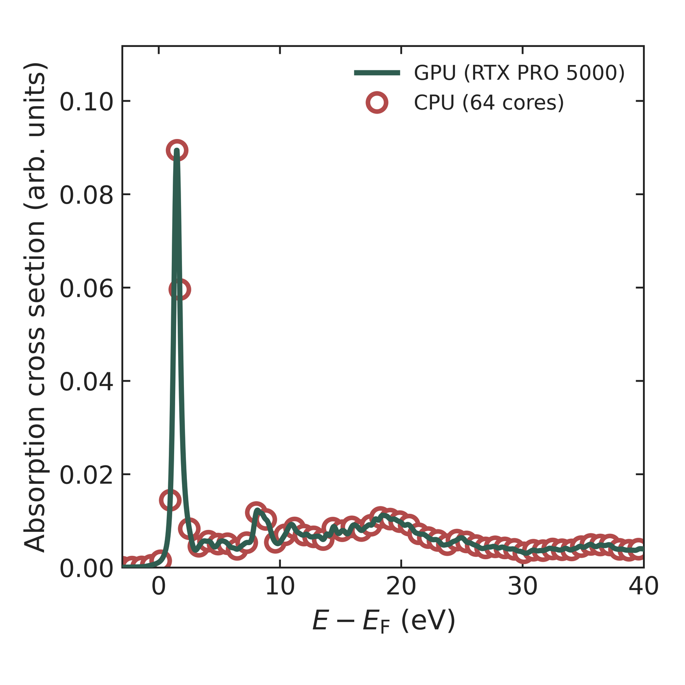
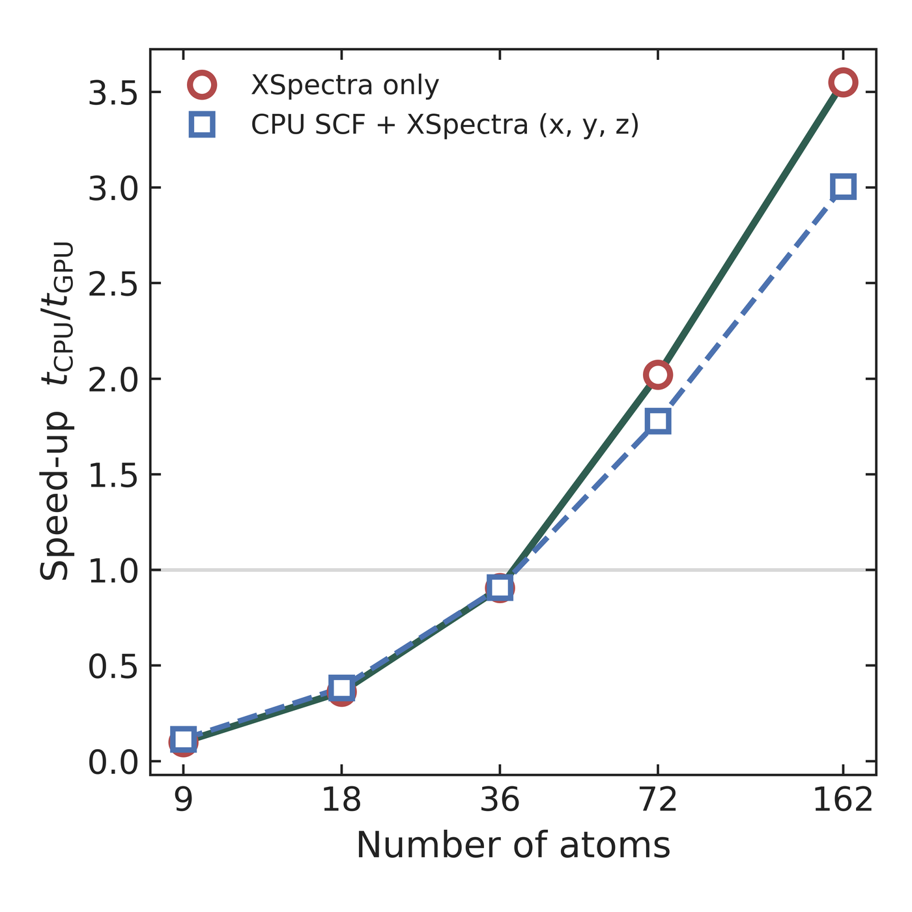
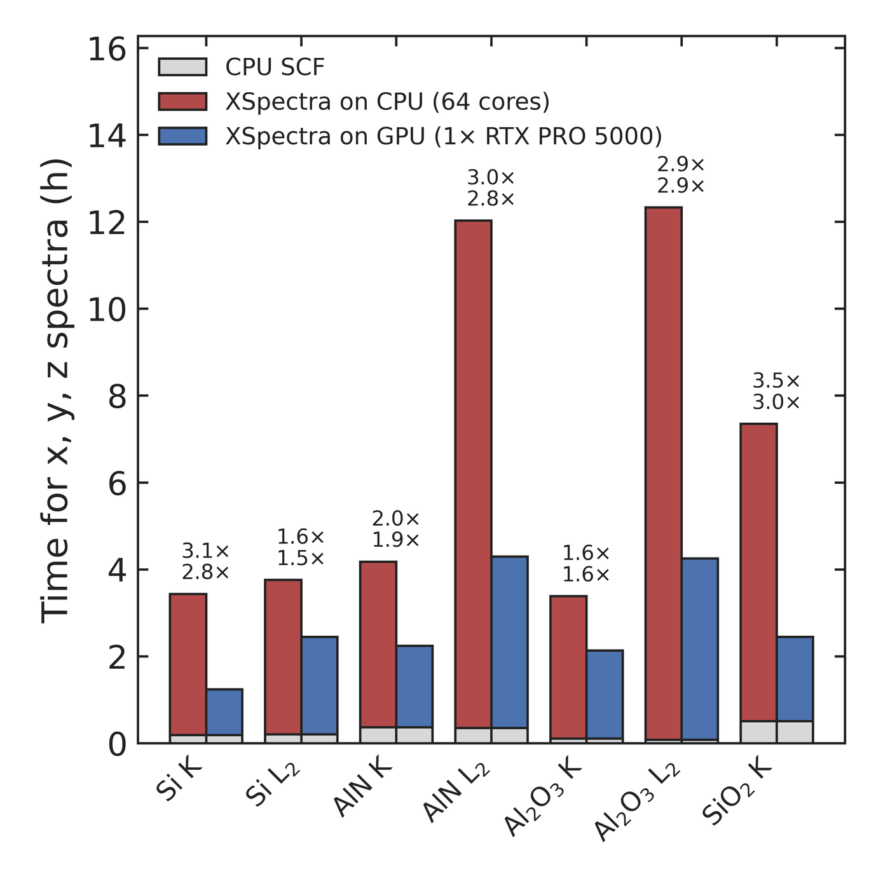
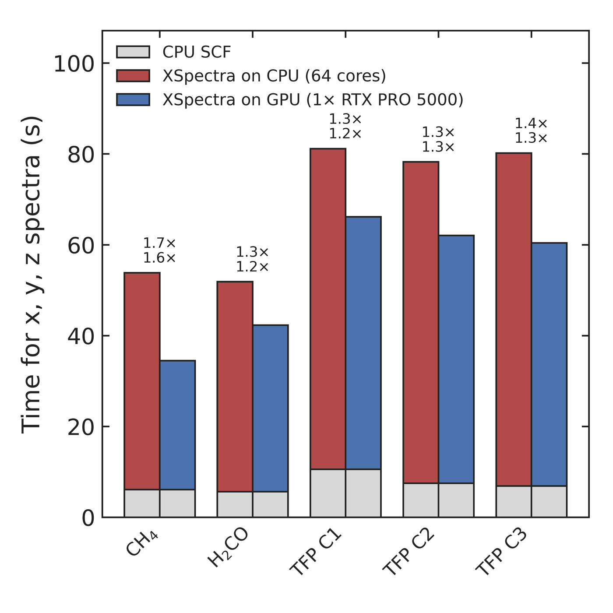
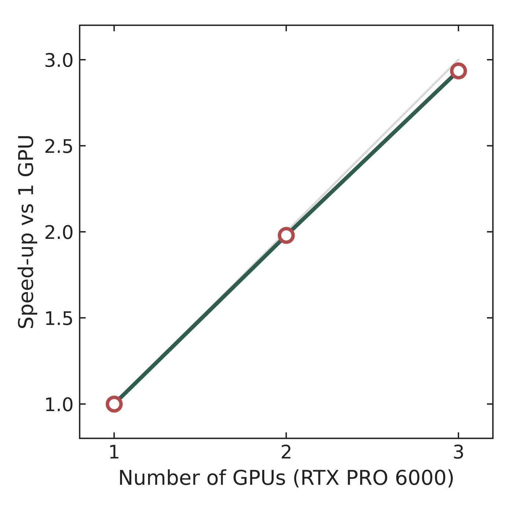
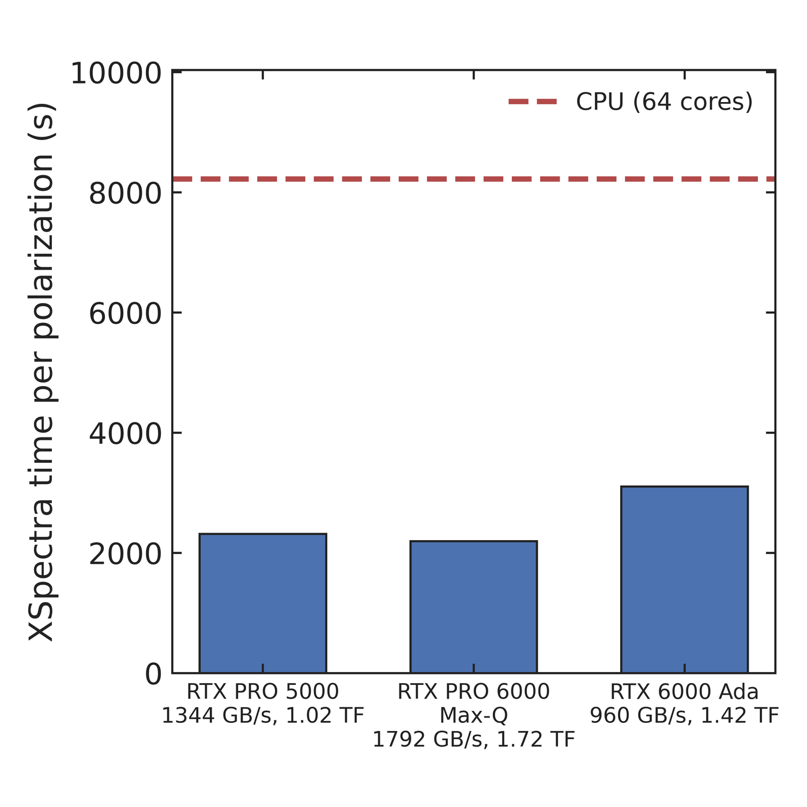

# XSpectra on the GPU (OpenACC) — patches for dm_qe

GPU port of Quantum ESPRESSO's `xspectra.x`: X-ray absorption with ultrasoft/PAW pseudopotentials, covering the
K edge (dipole and quadrupole) and the L₁, L₂ and L₃ edges. It runs on top of
[Discovered Materials' GPU fork of Quantum ESPRESSO (dm_qe)](https://github.com/discovered-materials/dm_qe).

This repository contains **only our changes**, as `git format-patch` patches, together with the build
and run scripts, the analysis tools and the validation and benchmark results. The base code is not
included: get it from the dm_qe repository and apply the patches.

**Preprint**: the implementation and the benchmark are described in detail in our ChemRxiv preprint,
Y. Wang and T. Mizoguchi, *GPU acceleration of first-principles X-ray absorption spectra: an OpenACC port of
XSpectra in Quantum ESPRESSO*, ChemRxiv (2026), [doi:10.26434/chemrxiv.15012423/v1](https://doi.org/10.26434/chemrxiv.15012423/v1).

**Highlights**
- **Validation**: the GPU results agree with the CPU code to the level at which CPU runs with different MPI
  layouts agree with each other. This was checked on solids and molecules.
- **Speed**: for a 162-atom α-SiO₂ supercell (Si K edge), one RTX PRO 5000 workstation GPU runs XSpectra
  3.6× faster than a 64-core Xeon node. The whole calculation, with the SCF on the CPU, is 3.0× faster
  (7.3 h → 2.4 h).
- **Several GPUs**: k-point pools scale almost ideally (2.94× on 3 GPUs).

## Applying the patches

```bash
git clone https://github.com/discovered-materials/dm_qe.git
cd dm_qe
git checkout -b xspectra-gpu 459623780      # base commit the patches were made on
git submodule update --init
git am /path/to/this/repo/patches/*.patch
```

The 9 patches apply cleanly to `459623780`. The resulting tree is identical to the branch that was
built and tested. Build with the dm_qe GPU configuration (NVHPC, `-DQE_GPU="openacc;cuda"`); the target
is `qe_xspectra_exe`:

```bash
SRC=$PWD BLD=$PWD/build_gpu FFTW3_ROOT=/path/to/fftw bash /path/to/this/repo/scripts/build_xspectra.sh
```

See the comments in `scripts/build_xspectra.sh` for the GPU architectures, the CPU reference build,
and the host target option for GPU hosts without AVX-512.

| patch | content | affects |
|---|---|---|
| 0001 | local: `-Mnoinline` for wannier90 `disentangle.F90` (nvfortran 26.3 internal compiler error) | build only |
| 0002 | GPU step 1: device data regions around `h_psi` in the Lanczos routines | GPU build |
| 0003 | `use_gpu = check_gpu_support()` at start-up (without it `h_psi` used a stale host `becp`) | GPU build |
| 0004 | GPU step 2: device-resident Lanczos recursion and S⁻¹ (`lanczos_acc.f90`, `sm1_psi_acc`) | GPU build |
| 0005 | norm-conserving Lanczos stops with an error on the GPU (not validated) | GPU build |
| 0006 | timing breakdown (clocks only) | both |
| 0007 | S⁻¹ matrix B = vkb^H vkb built on the device, once per k-point (it was 800 s of a 1040 s run) | GPU build |
| 0008 | the SCF wavefunctions are no longer read and copied (XSpectra never uses them) | both, bit-identical results |
| 0009 | optional `xepsilon_xyz = .true.`: x, y and z polarizations in one run (default off) | both |

The CPU build gives bit-identical results before and after these patches (checked with Intel/MKL),
except for the timing printout.

## Recommended workflow: SCF on the CPU, XSpectra on the GPU

- **Where to run each step**: run the SCF (`pw.x`) on a CPU node and XSpectra on the GPU.
  - The GPU `xspectra.x` reads the save directory written by a CPU `pw.x` directly. This was checked with
    Intel/MKL-built CPU runs.
  - On RTX workstation cards the SCF is slower on the GPU than on a 64-core CPU node, because it is limited by
    the cards' low FP64 throughput (162-atom SiO₂, 8 k points: 3,208 s on one RTX PRO 5000 vs 1,862 s on the
    CPU node).
  - XSpectra's Lanczos recursion is limited by memory bandwidth instead, so it benefits from the GPU.
- **When the GPU pays off**: for cells of more than about 40 atoms. In smaller cells with dense k-point grids,
  a CPU node that runs many k points in parallel is faster. See the system-size figure in the benchmark
  section below.
- **Several GPUs**: use k-point pools, `mpirun -np N xspectra.x -nk N`, with one rank per GPU.
- **Polarizations**: run x, y and z as separate jobs. `xepsilon_xyz` is correct, but on these cards it is
  slower than three separate runs, because the 3-column projector products fall onto slow FP64 tensor-core
  GEMM kernels.
- **Iteration count**: if the spectrum is broadened afterwards (e.g. Gaussian 0.2 eV × Lorentzian 0.1 eV),
  2,000 Lanczos iterations per k point already give the converged result within 1e-5 up to 40 eV above E_F.

## Validation

- **Criterion**: the GPU results must lie within the spread of CPU runs that differ only in the number of
  MPI ranks and in the compiler (NVHPC and Intel). Lanczos without reorthogonalization amplifies rounding
  differences, so runs are compared with three measures:
  - the Lanczos coefficients a, b over the first 50 iterations (agreement of about 1e-10 or better);
  - the broadened spectrum;
  - the iteration counts (±10 %).

  Script: `tools/ensemble_check.py`. Development checks were run on a 9-atom cell, for the dipole and quadrupole
  K edge and the L₃ edge, with k-point pools and with several ranks sharing one GPU.
- **Benchmark cases**: all cases in the benchmark below were compared with the CPU code reading the same SCF
  data (see the correctness notes there).

<p align="center"></p>

The figure shows the Si K edge of 162-atom α-SiO₂ (average of x, y and z, 36 k points, Lanczos run to
convergence), computed from the same SCF data on the CPU (64 cores, open circles) and on the GPU (one RTX PRO
5000, line).
- **Broadening**: both spectra are broadened in the same way, with a Gaussian exp(−(E/0.2)²) and a Lorentzian of
  HWHM 0.1 eV. The intensities are not normalized.
- **Agreement**: the largest difference between −3 and 40 eV is 1.1e-6 of the peak height, and the Lanczos
  coefficients of the first 50 iterations agree to 1.1e-10.
- **Script**: `tools/plot_cpu_vs_gpu_spectrum.py`.

## Benchmark: system size, edges, materials and molecules

The benchmark compares one GPU (RTX PRO 5000 Blackwell) with a 64-core CPU node on the same jobs. It then looks
at multi-GPU runs and other GPU models on the 162-atom SiO₂ cell, and at the Si L₁ and L₂ edges of the same cell.

**Common settings**
- **Method**: XCH core hole with pslibrary 1.0.0 PAW datasets and an absorber dataset generated with `ld1.x`;
  ENCUT 600 eV.
- **k points**: Γ-centred grid with spacing 0.030 Å⁻¹ (2π included; the VASPKIT convention). Molecules use
  Γ only in a 15 Å box.
- **Lanczos**: run to convergence (`xniter = 20000`, `xerror = 1e-3`, `xgamma = 0.05 eV`), one run per
  polarization.
- **Timing**: wall time from the `xanes` timer, median of two runs per polarization.
- **Same input on both sides**: the CPU and GPU XSpectra runs read the same CPU SCF save directory.

**Hardware and builds**
- **GPU**: one MPI rank and 8 OpenMP threads. The rest of the card's memory is held by a placeholder
  process, so the whole card is reserved.
- **CPU**: 64 MPI ranks with k-point pools, Intel oneAPI + MKL.

### System size (α-SiO₂ supercells, Si K edge, 9 to 162 atoms)

<p align="center">

</p>

Speed-up = CPU time / GPU time.
- **Circles, "XSpectra only"**: XSpectra alone, one polarization.
- **Squares, "CPU SCF + XSpectra (x, y, z)"**: the whole workflow, i.e. CPU SCF plus the x, y and z spectra,
  with the SCF on the CPU in both cases.

How the speed-up changes with size:
- **Small cells**: the k-point grid is dense (448 k points for 9 atoms) and each k point is cheap. The CPU
  processes 64 k points at a time (one per pool), while one GPU works through them one after another, so
  the GPU is slower.
- **Break-even**: around 40 atoms.
- **72 atoms**: the GPU is 2.0× faster for XSpectra alone and 1.8× faster for the whole workflow.
- **162 atoms** (36 k points): XSpectra takes 8,225 s per polarization on the CPU node and 2,317 s on the GPU
  (3.6×). With the 1,827 s CPU SCF, the x, y, z calculation takes 7.3 h on the CPU node and 2.4 h with
  XSpectra on the GPU (3.0×). The GPU uses 10.0 GiB of device memory.
- **Cost per Lanczos step**: per k point it grows from 0.56 ms (9 atoms) to 10.6 ms (162 atoms) on the GPU,
  and from 0.06 ms to 38.4 ms on the CPU.

### Materials and molecules

<p align="center">


</p>

**Solids (left) and molecules (right).** Each case has two bars: CPU on the left, GPU on the right.
- **Bars**: the grey part is the CPU SCF; red/blue is the time for the x, y and z spectra on the CPU/GPU.
- **Numbers above each pair**: the upper one is the speed-up of XSpectra alone; the lower one is the speed-up
  of SCF + XSpectra.
- **L₂,₃ edges**: computed with `edge = 'L2'`; L₃ is obtained afterwards as 2 × L₂ shifted by the 2p
  spin–orbit splitting.

| system | atoms | k points | edge | XSpectra speed-up | SCF + XSpectra speed-up | GPU memory (peak) |
|---|---|---|---|---|---|---|
| Si (diamond) | 64 | 64 | K / L₂ | 3.1 / 1.6\* | 2.8 / 1.5\* | 6.1 GiB |
| w-AlN | 108 | 75 | K / L₂ | 2.0\* / 2.9 | 1.9\* / 2.8 | 6.1 GiB |
| α-Al₂O₃ | 120 | 75 | K / L₂ | 1.6\* / 2.9 | 1.6\* / 2.9 | 6.1 GiB |
| α-SiO₂ | 162 | 36 | Si K / L₁ / L₂ | 3.6 / 3.5 / 3.5 | 3.0 / 3.3 / 3.3 | 10.0–10.3 GiB |
| CH₄, H₂CO, CF₃C≡CH (each C) | 4–7 | Γ | C K | 1.2–1.7 | 1.2–1.6 | 4.2–4.4 GiB |

\* **Two CPU node types**: the CPU runs used two node types with the same core count.
- **Unstarred entries**: 2 × Xeon Gold 6530.
- **Starred entries**: 2 × Xeon Gold 6538Y+.
- **Effect on the speed-up**: XSpectra runs faster on the 6538Y+ node, so starred speed-ups are lower;
  compare speed-ups only between entries of the same kind.

**Correctness (GPU vs CPU, same SCF data)**: in all cases above:
- the broadened spectra (Gaussian 0.2 eV × Lorentzian 0.1 eV, −3 to 40 eV) agree to ≤ 8e-5 of the maximum;
- the total number of Lanczos iterations agrees to ≤ 10.5 %.

The Lanczos coefficients a, b of the first 50 iterations agree to ≤ 1.6e-10, with one exception, CF₃C≡CH.
There, the chains start to differ after about 42 iterations: in a molecule the few sharp peaks converge
early, and loss of orthogonality then amplifies rounding errors. The same divergence appears between two
CPU runs with 16 and 64 MPI ranks, so it is not caused by the GPU.

### Several GPUs and other GPU models (162-atom SiO₂, Si K edge)

<p align="center">


</p>

**Several GPUs (left)**: k-point pools (`-nk` = number of GPUs) with one MPI rank per GPU, on RTX PRO 6000
Blackwell Max-Q cards. The 36 k points split evenly over 2 or 3 GPUs, and the scaling is almost ideal.

**Other GPU models (right)**: one GPU each; the dashed line is the 64-core CPU node. The labels give the
memory bandwidth and the FP64 peak (NVIDIA figures; FP64 = FP32/64). The cards are ordered by memory
bandwidth, not by FP64 peak: the RTX 6000 Ada has a higher FP64 peak than the RTX PRO 5000 but is 1.3× slower.

| GPUs | time per polarization | speed-up vs CPU node | SCF + XSpectra speed-up | GPU memory (peak, per card) |
|---|---|---|---|---|
| 1 × RTX PRO 5000 Blackwell | 2,317 s | 3.6 | 3.0 | 10.0 GiB |
| 1 × RTX 6000 Ada | 3,106 s | 2.6 | 2.4 | 10.1 GiB |
| 1 × RTX PRO 6000 Blackwell Max-Q | 2,196 s | 3.7 | 3.1 | 10.5 GiB |
| 2 × RTX PRO 6000 Blackwell Max-Q | 1,109 s (1.98× vs 1 GPU) | 7.4 | 5.1 | 7.6 GiB |
| 3 × RTX PRO 6000 Blackwell Max-Q | 748 s (2.94× vs 1 GPU) | 11.0 | 6.5 | 6.6 GiB |

All GPU runs agree with the CPU run to ≤ 1.1e-10 (a, b, first 50 iterations) and ≤ 2.2e-6 (spectrum).

## Limitations

- **Tested environment**: NVIDIA HPC SDK 26.3 (CUDA 13.1). GPUs: RTX PRO 5000/6000 Blackwell, RTX 6000
  Ada and A100; the A100 had driver 550 and used the SDK's CUDA forward-compatibility library. CPU reference
  builds: NVHPC and Intel oneAPI 2023.2 + MKL.
- **Validated cases**:
  - K-edge dipole: on SiO₂ supercells of 9–162 atoms, on Si, AlN and Al₂O₃, and on the C K edge of
    molecules (see the benchmark section);
  - L₂ edge: on Si, AlN, Al₂O₃ and 162-atom SiO₂ (64–162 atoms);
  - L₁ edge: on 162-atom SiO₂ and a 9-atom test cell;
  - K-edge quadrupole and the L₃ edge: on the 9-atom test cell only;
  - k-point pools (`-nk`), several MPI ranks sharing one GPU, and 2–3 GPUs with one rank per GPU.
- **Stops with an error on the GPU**: norm-conserving pseudopotentials, `gamma_only`, noncollinear
  calculations, and `xepsilon_xyz` together with `restart`/`xonly_plot`.
- **Reproducibility**: Lanczos without reorthogonalization amplifies rounding differences. GPU and CPU
  spectra therefore agree to the level that CPU runs with different MPI layouts agree with each other,
  not bit for bit.

## Layout

```
patches/                  9 patches on dm_qe 459623780
docs/img/                 figures used in this README
scripts/                  build_xspectra.sh (NVHPC, GPU or CPU), build_xspectra_intel_cpu.sh,
                          run_xspectra_gpu.sh (one GPU, optional CUDA forward compatibility),
                          run_scf_cpu.slurm (example: SCF on a CPU node)
tools/                    compare_xs.py (compare two runs), ensemble_check.py (validation criteria),
                          plot_timing_bar.py, plot_cpu_vs_gpu_spectrum.py,
                          fp64emu/ (cuBLAS FP64-emulation ZGEMM benchmark and results)
tests/pseudo_generation/  ld1.x input of the Si 1s core-hole PAW dataset
```

The pseudopotentials are not included: the Si and O PAW datasets are pslibrary 1.0.0
(`*.pbe-n-kjpaw_psl.1.0.0.UPF`), and the core-hole dataset is generated with
`tests/pseudo_generation/Si_h.ld1.in`.

## How to cite

To cite this work, cite the preprint (item 1); there is no need to cite this repository separately.
Please also cite the codes it builds on (items 2–4). GitHub's "Cite this repository" button
(generated from `CITATION.cff`) gives the preprint.

1. **The preprint** describing this work: Y. Wang and T. Mizoguchi, *GPU acceleration of first-principles
   X-ray absorption spectra: an OpenACC port of XSpectra in Quantum ESPRESSO*, ChemRxiv (2026),
   [doi:10.26434/chemrxiv.15012423/v1](https://doi.org/10.26434/chemrxiv.15012423/v1).
2. **Quantum ESPRESSO**, as its developers ask (https://www.quantum-espresso.org/quote):
   - P. Giannozzi et al., J. Phys.: Condens. Matter **21**, 395502 (2009);
   - P. Giannozzi et al., J. Phys.: Condens. Matter **29**, 465901 (2017);
   - P. Giannozzi et al., J. Chem. Phys. **152**, 154105 (2020).
3. **XSpectra**, as printed by the program:
   - M. Taillefumier, D. Cabaret, A. M. Flank, and F. Mauri, Phys. Rev. B **66**, 195107 (2002);
   - Ch. Gougoussis, M. Calandra, A. P. Seitsonen, and F. Mauri, Phys. Rev. B **80**, 075102 (2009);
   - O. Bunau and M. Calandra, Phys. Rev. B **87**, 205105 (2013).
4. **dm_qe**, the GPU fork this work is built on: link to
   https://github.com/discovered-materials/dm_qe, as its authors ask.

BibTeX for the preprint:

```bibtex
@article{Wang2026XSpectraGPU,
  author  = {Wang, Yinan and Mizoguchi, Teruyasu},
  title   = {{GPU} acceleration of first-principles {X}-ray absorption spectra: an {OpenACC} port of
             {XSpectra} in {Quantum ESPRESSO}},
  journal = {ChemRxiv},
  year    = {2026},
  doi     = {10.26434/chemrxiv.15012423/v1},
  url     = {https://doi.org/10.26434/chemrxiv.15012423/v1}
}
```

## License and credit

The patches modify Quantum ESPRESSO / dm_qe source files and are distributed under the same license,
the GNU General Public License v2 or later (see `LICENSE`). If you use this work, cite Quantum ESPRESSO
(<https://www.quantum-espresso.org/quote>) and link to the dm_qe repository, as its authors ask.
